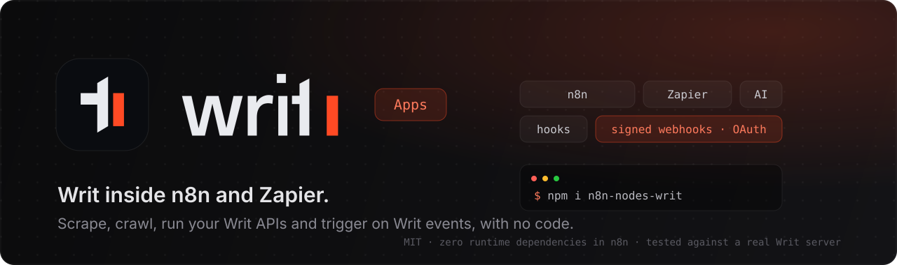

<div align="center">
  

  <br/>

  <p align="center">
    <a href="https://github.com/usewrit/writ-integrations/actions/workflows/ci.yml"></a>
    <a href="https://www.npmjs.com/package/n8n-nodes-writ"></a>
    <a href="./LICENSE"></a>
  </p>

  <h3 align="center">Writ inside n8n and Zapier.</h3>

  <p align="center">
    <a href="./n8n"><b>n8n</b></a> ·
    <a href="./zapier"><b>Zapier</b></a> ·
    <a href="./DESIGN.md"><b>Contract</b></a> ·
    <a href="./SECURITY.md"><b>Security</b></a> ·
    <a href="./CONTRIBUTING.md"><b>Contributing</b></a>
  </p>
</div>

---

Official no-code integrations for [Writ](https://usewrit.app), which turns any website into an
API. Read a page as clean markdown, map or crawl a site, run the APIs you built in Writ with
your own inputs, watch pages for changes, and start a workflow the moment Writ reports
something: a page changed, a run finished, a crawl is done, a monitor went down.

| Platform | Folder | Install |
|---|---|---|
| **n8n** | [`n8n/`](./n8n) | Settings, Community Nodes, install `n8n-nodes-writ` |
| **Zapier** | [`zapier/`](./zapier) | Search for **Writ** in the Zap editor |

Both are thin clients over the same Writ REST API and follow one contract
([`DESIGN.md`](./DESIGN.md)): the same operations, the same error meanings, the same webhook
signature check.

## What you can do

| | n8n | Zapier |
|---|---|---|
| Scrape a page (markdown or HTML) | Writ, Page, Scrape | Scrape Page |
| Map a site's URLs | Writ, Page, Map Site | Map Site |
| Start a crawl, read its status and pages | Writ, Crawl | Start Crawl, Crawl Finished |
| Run a saved workflow with inputs | Writ, Workflow, Run | Run Workflow |
| Read a workflow's run or its collected data | Writ, Workflow, Get Run / Get Data | Find Records |
| Create a monitor, check it now, read its changes | Writ, Monitor | Create Monitor, Check Monitor Now, Find Monitor |
| Start when a page changes | Writ Trigger, Writ Changes Trigger | New Change Detected |
| Start when a run finishes | Writ Trigger | Workflow Run Finished |
| Start when a monitor goes down or recovers | Writ Trigger | Monitor Status Changed |

The n8n node is also usable as a tool by n8n's AI Agent, so an agent can read a site that has
no API through Writ.

Calls use your Writ account's credits exactly as they do from the Writ app or the API.

## Repository layout

```
n8n/       n8n community node package (npm: n8n-nodes-writ)
zapier/    Zapier CLI app
DESIGN.md  the contract both follow
```

## License

[MIT](./LICENSE)
